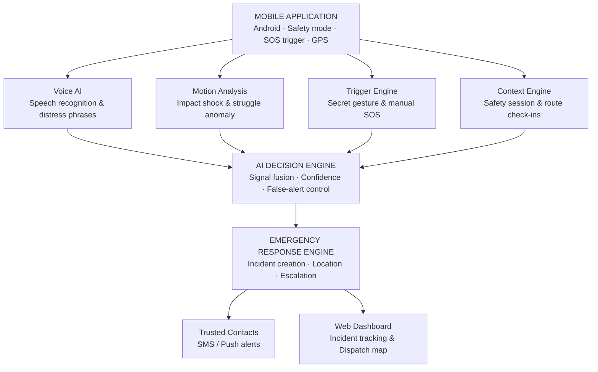

# SilentSOS – Intelligent Emergency Detection (SENTINEL AI)

> **AI + Safety Platform**: Designed for life-critical situations where a person cannot unlock their phone, make calls, or communicate their location.

---

## 🌟 Problem & Innovation

### The Problem
During emergencies, individuals may not be able to unlock their phones, dial numbers, or communicate their location without escalating danger. Assailants often monitor phones, and panic impairs fine motor skills required for standard unlock gestures or 911 calls.

### Our Innovation
- **Voice-Triggered Emergency Activation**: Continual background speech processing powered by Whisper/Vosk keyword spotting with acoustic stress detection.
- **Discreet Emergency Alert**: Silent distress beacon without screen flash, vibrations, or loud alarms to prevent drawing attacker attention.
- **Location Sharing with Trusted Contacts**: Real-time high-precision GPS breadcrumbs sent to registered "Guardian Angels" via SMS/push dispatch.
- **Detects Predefined Distress Phrases**: Spots phrases like *"someone is following me"*, *"help me"*, *"save me"*, *"code red"*, and user-configured codewords (e.g. *"pineapple"*).
- **Hidden Triggers**: Physical volume key cadence (Down-Up-Down within 1.5s), accelerometer impact/fall anomaly (>3.5G), and covert calculator disguise where typing `911 =` silently dispatches emergency responders.

---

## 📐 SENTINEL AI Architecture



---

## 🛠️ Technology Stack

| Component | Architecture Specification | Implementation in this Platform |
|---|---|---|
| **Mobile Application** | Flutter | Interactive Smartphone Simulator with Safe & Emergency Modes |
| **Backend** | Python + Flask / FastAPI | Flask 3.1.3 WSGI application with Server-Sent Events (SSE) |
| **Voice Recognition** | Whisper / Vosk | Web Speech API + Fuzzy Keyword Spotter & Acoustic Stress Scorer |
| **Audio Classification** | YAMNet / CNN | Acoustic stress analyzer (pitch jitter, scream & distress event classifier) |
| **Motion Analysis** | TensorFlow Lite | Accelerometer impact shock (>3.5G) & struggle oscillation detection |
| **Location** | Android GPS + Maps SDK | Leaflet.js + HTML5 Geolocation with real-time breadcrumbs |
| **Notifications** | Firebase Cloud Messaging | Angel SMS alert dispatch engine + Web Audio siren synthesizer |
| **Database** | PostgreSQL / SQLite | SQLite3 WAL mode with full audit trail logs and contacts schema |
| **Dashboard** | React / Web Dashboard | Guardian Operations Command Center with Live Map & Threat Matrix |

---

## 🚀 Getting Started

### 1. Requirements
- Python 3.10+
- Flask 3.0+

### 2. Run the Application
```bash
python app.py
```
Open **`http://127.0.0.1:5000`** in your web browser.

---

## 📱 Navigation & Features

1. **Overview (`/`)**:
   - System specifications, problem & innovation breakdown, and live platform telemetry.
2. **Mobile Device Simulator (`/mobile`)**:
   - **Safe Mode**: Interactive GPS journey map with nearby Guardian Angels.
   - **Emergency Mode**: Glowing central **"HOLD TO CALL ANGELS"** button with circular 3-second hold progress, quick audio streaming, siren alarm, and 911 dialer.
   - **Covert Calculator**: Functional calculator with secret `911 =` SOS trigger.
   - **Voice AI Listener**: Live microphone speech recognition detecting distress keywords.
   - **Secret Gestures**: Hardware volume button sequence (Down-Up-Down), 4.5G fall shock, and violent struggle shake.
3. **Guardian Operations Dashboard (`/dashboard`)**:
   - Live Incident Feed with active threat confidence scores (0–100%).
   - Interactive Leaflet Command Map with pulsating red emergency beacons.
   - Encrypted activity audit trail and instant **"Escalate 911"** dispatch.
4. **Architecture Explorer (`/architecture`)**:
   - Interactive SENTINEL AI block diagram.
   - Live Signal Fusion sandbox with sliders for Voice, Motion, Trigger type, and Session risk.
5. **Guardian Angels (`/contacts`)**:
   - Manage emergency contacts, toggle Primary Angel status, and set SMS/Call preferences.
6. **Safety Sessions (`/sessions`)**:
   - "Walk with Me" timed check-ins with automatic SOS escalation on timer expiry.

---

## 🔒 False-Alarm Control
To prevent accidental alerts, medium-urgency triggers initiate a discreet 10-second silent countdown grace period. The user can cancel the alert at any time by entering their safety PIN (default: `1234`). High-threat triggers (Threat Score ≥ 80%) instantly escalate without delay.